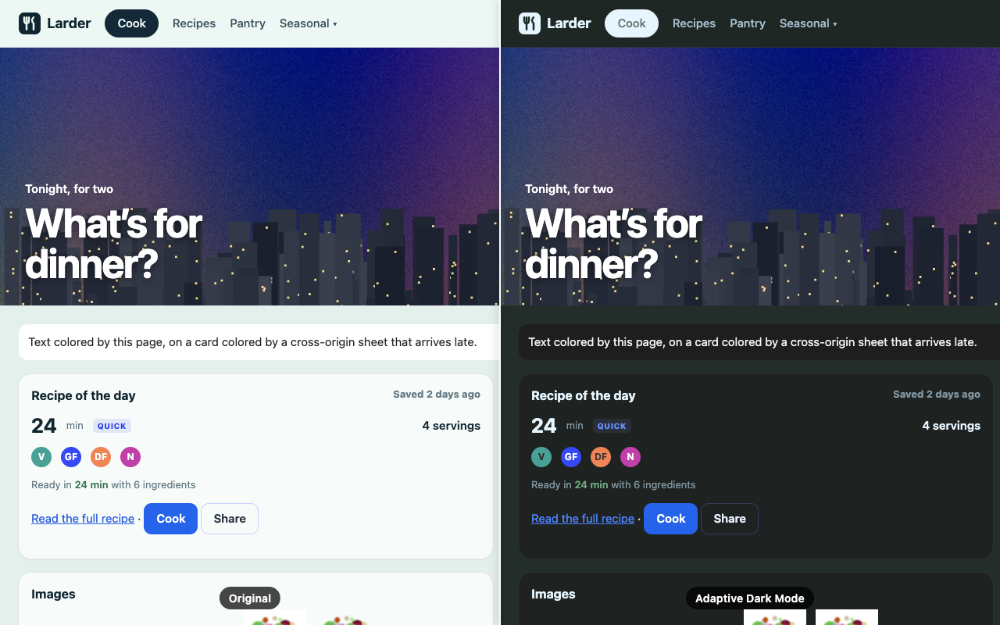
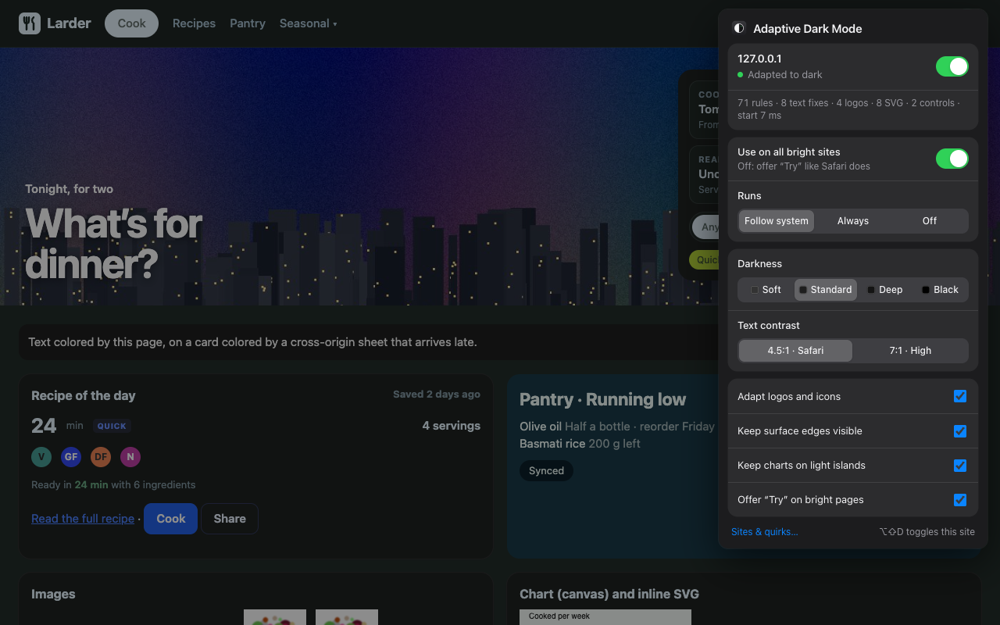
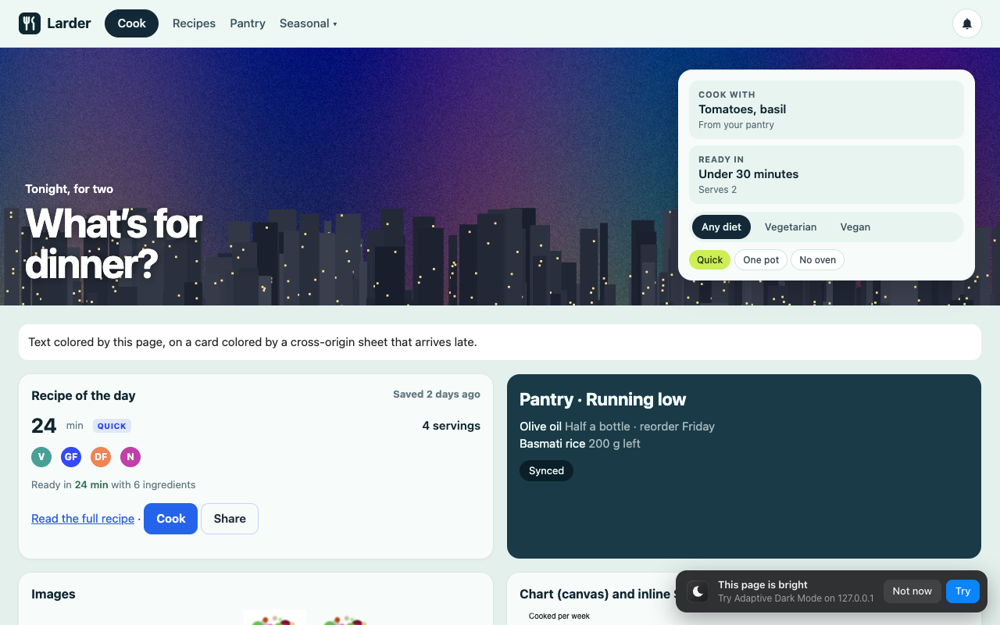

# Adaptive Dark Mode for Chrome

[](https://github.com/QuantIntellect/adaptive-dark-mode/actions/workflows/ci.yml)
[](LICENSE)


Light websites, presented dark while you browse in dark mode.

This is a Manifest V3 Chrome extension modelled on the **Adaptive Dark Mode** that Apple introduced in Safari 27.3.
Light surfaces become dark and dark text becomes light. Hues and brand colors stay, and photos, video and canvas are
left as the author made them. Text is pushed to WCAG 4.5:1 against whatever is actually painted behind it.



> **Independent project.** Not affiliated with or endorsed by Apple. Safari is a trademark of Apple Inc. The behavior
> is modelled on Apple's announcement, WebKit's open-source code and the screenshots Apple published. It has not yet
> been compared side by side with Safari itself.

## Install

**From a release (recommended)**

1. Download `adaptive-dark-mode-<version>.zip` from [Releases](https://github.com/QuantIntellect/adaptive-dark-mode/releases)
   and unzip it.
2. Open `chrome://extensions`, turn on **Developer mode** (top right), click **Load unpacked** and choose the
   unzipped folder.

**From source**

```
git clone https://github.com/QuantIntellect/adaptive-dark-mode.git
```

Then choose the cloned folder with **Load unpacked**. To update later, run `git pull` and click the reload icon on
the extension's card.

**Chrome Web Store**: not listed yet. The submission kit (listing text, privacy answers, screenshots) is in
[store/listing.md](store/listing.md).

## Use

- By default it runs only while your system or Chrome uses a **dark** appearance ("Follow system"). If your system is
  light and you want it anyway, open the toolbar popup and set **Runs** to **Always**.
- On a bright page a small **"This page is bright · Try"** card appears, like Safari's preview. **Try** adapts the page
  and remembers the site. The card then offers **Undo** and **All bright sites**.
- **⌥⇧D** (Alt+Shift+D) toggles the current site.
- Sites that already have a dark theme, or declare `color-scheme: light dark` or `light only`, are never touched.

| Popup | Try offer |
|---|---|
|  |  |

**Popup settings**: per-site on/off, use on all bright sites, runs (Follow system, Always, Off), **darkness** (Soft
`#333`, Standard `#1e1e1e`, Deep, Black), **text contrast** (4.5:1 like Safari, or 7:1), and switches for logos and
icons, surface edges, chart islands and the Try offer.

**Options page**: the list of sites you switched on or off, quirks (disable a site, force-invert or preserve elements
by selector), built-in quirks, export, import and reset.

## How it works

The full research is in **[docs/how-safari-does-it.md](docs/how-safari-does-it.md)**. It covers what Apple announced,
what WebKit's open-source hooks reveal (internally *AX Custom Color Mode*: a two-phase background-collection and
backdrop pass, paint-time text adjustment, an SVG classifier, bitmap invert modes), the color model fitted to Apple's
screenshots, and how each engine mechanism maps to something an extension can do.

| Modelled on Safari | How the extension does it |
|---|---|
| Runs only in dark mode, only where you allow it | "Follow system" mode, per-site on/off, "Use on all bright sites" |
| Leaves sites with their own dark mode alone | `color-scheme: light dark` / `light only` (meta or CSS) → untouched. Author-managed subtrees are excluded. |
| Leaves already-dark pages alone | Samples the rendered page after DOMContentLoaded. A cached verdict lets known bright sites start at `document_start`. |
| Light surfaces dark, dark text light, hue kept | A contrast-preserving luminance flip in OKLCH, anchored so white → `#1e1e1e` |
| Semantic colors keep their meaning | Vivid badges and buttons stay. Vivid links are lightened just enough. |
| Text readable on its real backdrop | Hit-tests what paints behind each text run, then 4.5:1 (or 7:1) |
| Text over photos untouched | Authored colors kept over images and video |
| Simple black-and-white logos inverted | Pixel histogram, dark monochrome SVGs, hue-preserving inversion |
| Canvas, video and photos untouched | Charts drawn dark-on-transparent keep a light backdrop. Iframes keep their transparency. |
| Blend modes that need a light page are turned off | `multiply`, `screen` and the like → `normal` |
| Per-site and per-element quirks | Options page: disable a site, force-invert or preserve elements |

**The color model.** Neutral and tinted colors are flipped with `Y' + 0.05 = k / (Y + 0.05)`, where `Y` is WCAG
relative luminance and `k` pins white to the chosen dark anchor. In `(Y + 0.05)` space this is an involution, so the
WCAG contrast ratio between any two flipped colors is preserved exactly. That matches what Apple's screenshots show for
cards on tinted pages. It reproduces Safari's paragraph text `#4a4a4a → #bebebe` (this model: `#bdbdbd`). Hue and chroma
are kept in OKLCH. Colors with chroma ≥ 0.08 (surfaces) or ≥ 0.15 (text) are treated as semantic and keep their color,
with text lightened only as far as the contrast target needs.

**The engine.** Every author declaration of a color property is mirrored, changed or not, with the same selector and
inside the same `@media`, `@supports`, `@layer`, `@container` or `@scope` context, or nesting. The mirrors go in
constructed style sheets adopted after the page's own sheets. Equal specificity plus later order means the mirrored
value wins, and mirroring unchanged declarations keeps the page's own cascade intact. The engine covers `:hover`,
pseudo-elements, keyframes, `@import` chains, cross-origin sheets (re-fetched by the service worker), open and closed
shadow roots, CSS-in-JS, inline styles and legacy `bgcolor`. CSS variables get per-role variants
(`--adm-bg-x`, `--adm-fg-x`, …), including shadcn-style HSL and Bootstrap-style RGB channel triplets. A layout pass then
handles what rules can't: text contrast against the real backdrop, small dark controls, hairlines, SVG and canvas.

## Verification

All checks run against the project's own fixtures in `test/fixtures/`: a recipe-site page that exercises
every rule case, opt-out pages, an already-dark page and a late-rendering SPA. Pages that must be left alone
are also compared pixel for pixel.

| Browser | Mode | Fixture checks |
|---|---|---|
| Chrome for Testing 153.0.8010.12 | headless | 66 / 66 |
| Google Chrome 157.0.8103.40 (macOS) | headed | 65 / 66. The miss is the pixel-identical "turned off" comparison. About 2,200 pixels around the two scaled product images differ, by 1 level out of 255 (15 in an earlier run). The separate "nothing left behind" check (0 attributes, 0 custom properties, 0 sheets) passed. The cause has not been isolated. |

Real sites, with the extension on (text elements sampled after scrolling). Google Chrome 157 and Chrome for Testing 153 gave the
same results. These are recorded, not pass/fail checks:

| Site | Result | Contrast failures |
|---|---|---|
| news.ycombinator.com | adapted | 0 / 254 |
| en.wikipedia.org | adapted | 0 / 94 |
| craigslist.org | adapted | 0 / 92 |
| stripe.com | adapted | 0 / 45 |
| bbc.com/news | adapted | 0 / 38 |
| apple.com/iphone | adapted | 0 / 24 |
| developer.mozilla.org, github.com, example.com | left alone (declare their own color scheme) | n/a |
| stackoverflow.com | left alone (already dark) | n/a |

lite.cnn.com and gnu.org were in the list but could not be reached from the test network.

**Cost.** Building the override sheets took about 1 ms on Hacker News, 45 to 75 ms on Wikipedia, 90 to 110 ms on
apple.com and 120 to 140 ms on stripe.com. The work is spread over many small passes. Total long-task time was too noisy
to pin down. Across three runs on stripe.com it ranged from 0.2 s lower to 1.7 s higher with the extension on. On
apple.com it was 0.07 to 0.2 s higher.

## Known limits

- **Pages can see it.** Safari changes only how things are painted, so computed styles stay as authored. An extension
  can only change paint by changing styles. `getComputedStyle`, `document.adoptedStyleSheets`, `data-adm-*`
  attributes and the main-world hook are all visible to page scripts.
- **Per element, not per paint.** Text fixes from the layout pass apply to an element, so they override that element's
  own `:hover` color change.
- **Sprites** are classified as a whole image, not by the part that is drawn.
- **First visit.** A site's first page is adapted after one detection pass at DOMContentLoaded, which can briefly show
  the light page. After that, it starts at `document_start`.
- **Frames that look dark**, such as some consent dialogs, are not adapted inside.
- **Timing.** Once on stripe.com (Chrome for Testing 153), a button's text was checked before a late style change
  settled and stayed white on a light button. It did not happen in the Chrome 157 run.
- **Calibration.** Apple's two published screenshots disagree on how dark white becomes. Standard uses `#1e1e1e`, and
  the Soft setting (`#333`) matches the other screenshot.

## Privacy

No account, no analytics, no server. Settings, site choices and a small light/dark cache of site names stay in
`chrome.storage.local`. To read the colors Chrome hides from content scripts, the service worker requests the page's
cross-origin style sheets and small logo images again, from the same URLs and without cookies. Full policy:
[PRIVACY.md](PRIVACY.md).

## Project layout

```
manifest.json
src/shared/color.js          color parsing (all CSS syntaxes), WCAG, OKLCH
src/shared/transform.js      the color model, value rewriting, CSS-variable role variants
src/shared/settings.js       defaults, per-site policy, built-in quirks
src/shared/imageclass.js     bitmap histogram and SVG paint classifier
src/content/page-hook.js     main-world signal for insertRule / adoptedStyleSheets / attachShadow
src/content/detect.js        color-scheme opt-out and light/dark page sampling
src/content/sheets.js        rule-level override engine (media, layers, nesting, @import, cross-origin, shadow roots)
src/content/inline.js        inline styles and bgcolor / <font color>
src/content/layout.js        backdrop pass: text contrast, small controls, hairlines, SVG, canvas islands
src/content/images.js        logo and icon classification and inversion
src/content/prompt.js        the in-page "Try" card
src/content/main.js          lifecycle and gates
src/background/service-worker.js   settings writer, cross-origin CSS fetch, image decode, badge, shortcut
src/popup, src/options       UI
docs/how-safari-does-it.md   the research
store/                       Chrome Web Store listing kit, screenshots and promo tile
test/unit, test/e2e, test/fixtures
scripts/pack.mjs, scripts/screenshots.mjs
```

## Development

No build step. Edit, then click the reload icon on the extension's card at `chrome://extensions`.

```
npm install              # playwright-core, used only by the e2e suite and the screenshot script
npm test                 # unit tests
npm run e2e              # end-to-end checks on the fixtures (add -- --sites for real websites)
npm run screenshots      # regenerate store/screenshots and the promo tile from the fixture
npm run pack             # dist/adaptive-dark-mode-<version>.zip (runtime files only)
```

Chrome 137 and later ignore `--load-extension`, so the e2e harness loads the extension with the CDP method
`Extensions.loadUnpacked`. See [CONTRIBUTING.md](CONTRIBUTING.md) for which Chrome builds work headless.

## License

[MIT](LICENSE)
